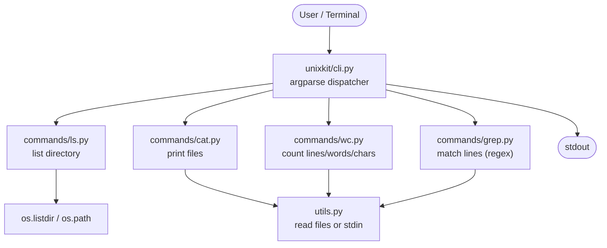

# unixkit 🐚

A tiny Unix-style command line toolkit in pure Python — no dependencies.
Four classic tools, each doing one thing well, composing through pipes
exactly like real Unix tools.

## Tools

| Command | Does what | Example |
|---|---|---|
| `ls` | Lists directory entries | `python -m unixkit ls -l` |
| `cat` | Prints files (or stdin) | `python -m unixkit cat notes.txt` |
| `wc` | Counts lines, words, chars | `python -m unixkit wc -l notes.txt` |
| `grep` | Prints matching lines | `python -m unixkit grep TODO notes.txt` |

## The Unix way: pipes

```bash
python -m unixkit cat notes.txt | python -m unixkit grep TODO
python -m unixkit cat notes.txt | python -m unixkit wc -l
```

## Project structure



```text
unixkit/
├── unixkit/
│   ├── __init__.py      # version
│   ├── __main__.py      # python -m unixkit entry point
│   ├── cli.py           # argument parsing + dispatch
│   ├── utils.py         # read files or stdin
│   └── commands/
│       ├── ls.py        # directory listing
│       ├── cat.py       # print files
│       ├── wc.py        # line/word/char counts
│       └── grep.py      # regex line matching
├── tests/
│   └── test_unixkit.py  # unit tests + a real pipe test
└── README.md
```

## How data flows


Every tool reads files — or stdin when no file is given — and writes
plain text to stdout. That is the whole Unix philosophy: small tools,
text streams, composable pipes.

## Run the tests

```bash
python -m unittest discover -s tests -v
```

## Requirements

Python 3.10+ only. No third-party packages.
